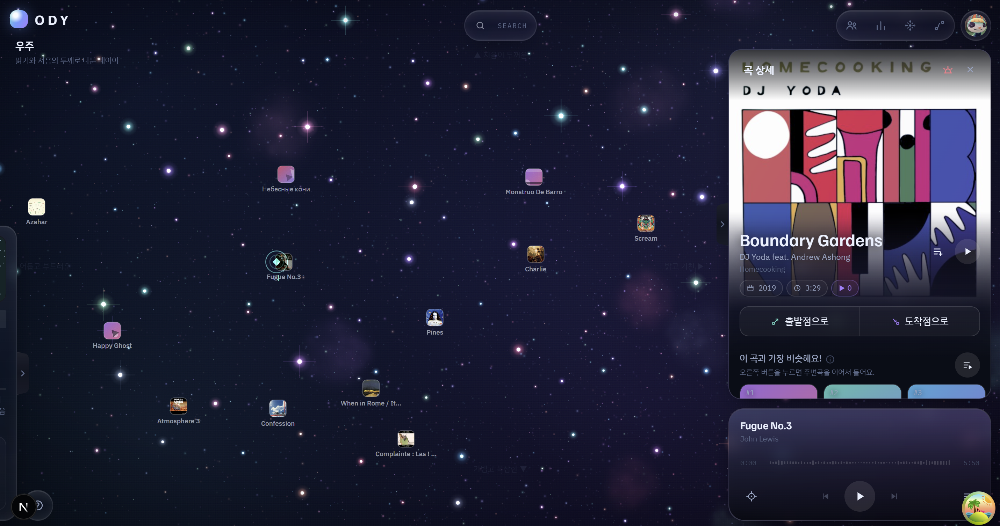
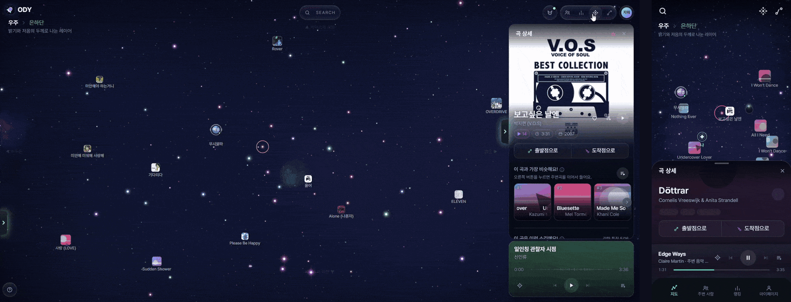
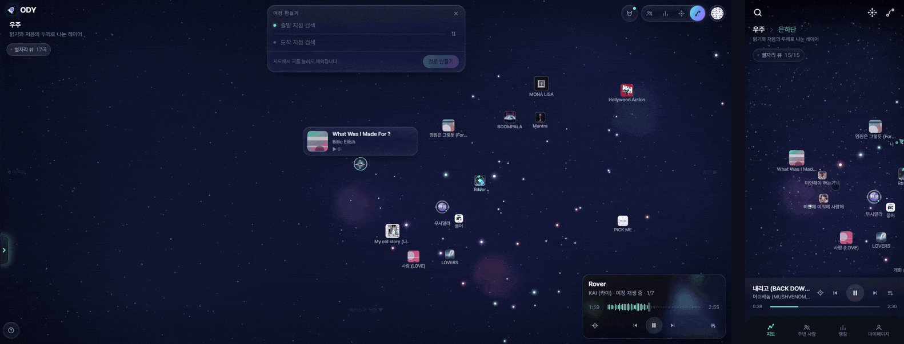
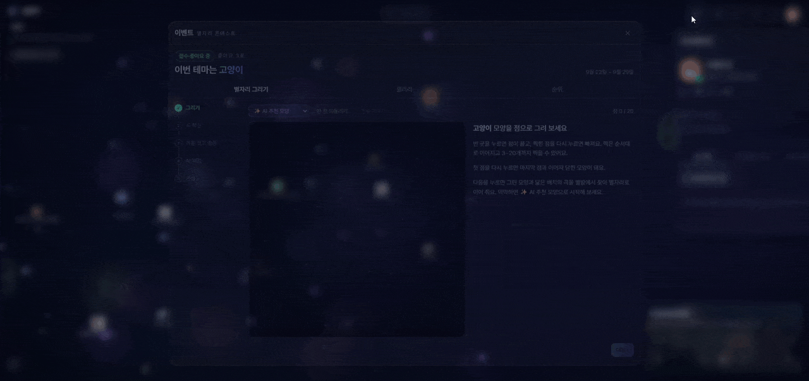
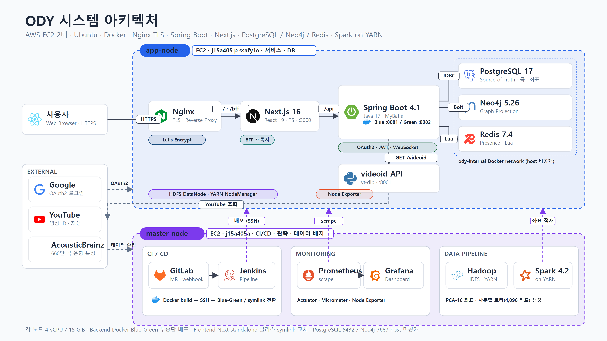
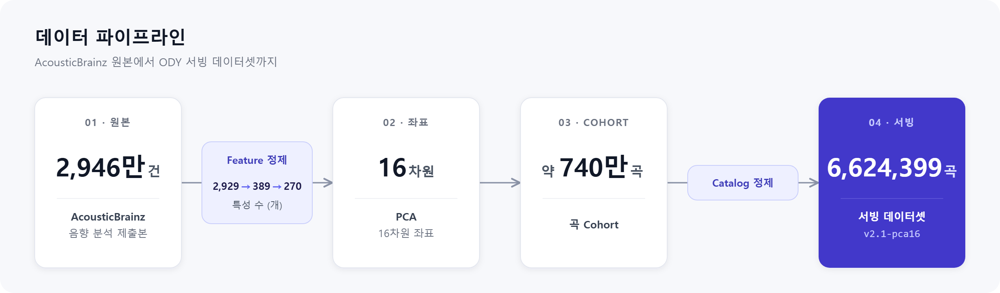

<div align="center">


# ODY

**소리의 성질로 그린 음악 지도**

약 465만 곡을 16차원 음향 좌표 공간에 펼쳐 두고,<br>
내 위치에서 가고 싶은 곳까지 직접 탐색하는 음악 탐색 서비스



<br>

SSAFY 15기 특화 프로젝트 · 2026.09.02 – 2026.09.28 · 6명<br>
원본 저장소: GitLab (SSAFY) → 이 저장소는 공개용 미러

</div>

<br>

## 목차

1. [프로젝트 소개](#1-프로젝트-소개)
2. [주요 기능](#2-주요-기능)
3. [어떻게 동작하나](#3-어떻게-동작하나)
4. [시스템 아키텍처](#4-시스템-아키텍처)
5. [데이터 파이프라인](#5-데이터-파이프라인)
6. [기술 스택](#6-기술-스택)
7. [저장소 구조](#7-저장소-구조)
8. [로컬 실행](#8-로컬-실행)
9. [팀](#9-팀)

<br>

## 1. 프로젝트 소개

스트리밍 서비스의 추천은 결과 목록만 보여 줍니다. 그 곡이 왜 추천됐는지, 내 취향이 음악 전체에서 어디쯤인지는 알 수 없습니다.

ODY 는 추천 결과 대신 **추천이 일어나는 공간 전체를 지도로** 보여 줍니다. 공개 음향 분석 데이터(AcousticBrainz)로 곡마다 수천 개의 측정값을 뽑아 **PCA 16차원 좌표**로 압축하고, 그 위에서 사용자가 직접 목적지를 고릅니다.

- **내 위치** — 지금 재생 중인 곡이 지도 위 내 좌표입니다.
- **깊이 탐색** — 장르 → 음향 특성(PC 레이어) 순으로 영역을 좁혀 들어갑니다.
- **여정** — 두 곡 사이를 자연스럽게 잇는 곡 순서를 만들어 줍니다.
- **별자리** — 플레이리스트를 모양으로 그리고, AI 가 주제와 닮은 정도를 채점합니다.
- **따라가기** — 같은 공간을 탐색 중인 다른 사용자의 화면에 실시간으로 동승합니다.

| 지표 | 값 |
| :--- | ---: |
| 원본 AcousticBrainz 제출본 | 29,460,584 건 |
| 음향 특성 | 2,929 → 389 → 270 개 선별 |
| 좌표 | PCA 16차원, 지도 레이어 8겹 |
| 서빙 곡 수 | **4,648,615 곡** (2026-09-23 운영 기준, 초기 적재 6,624,399 곡에서 카탈로그 규칙으로 정제) |
| 최근접 검색 | PostgreSQL pgvector `vector(16)` + HNSW |

<br>

## 2. 주요 기능

### 2.1 주변 탐색

곡을 고르면 아티스트·발매 연도·장르·앨범 커버와 지도상 위치를 보여 주고, 16차원 공간에서 가장 가까운 곡들을 함께 띄웁니다.

<p align="center"></p>

### 2.2 여정

출발 곡과 도착 곡을 고르면 그 사이를 잇는 곡들을 순서대로 만듭니다. 두 곡이 멀수록 경유 곡이 많아집니다. 만든 여정은 순서대로 재생하거나 플레이리스트로 저장할 수 있습니다.

<p align="center"></p>

### 2.3 별자리 작품 콘테스트

회차마다 주제(예: 고양이)가 주어지고, 곡들을 이어 별자리를 만들어 제출합니다. AI 가 주제와 닮은 정도를 채점하고, 다른 사용자의 좋아요(회차당 3표)와 합산한 리더보드로 순위를 겨룹니다.

<p align="center"></p>

### 2.4 따라가기

공개 계정 사용자의 탐색에 동승하면 인솔자가 레이어를 옮기고 곡을 고르는 대로 내 화면이 함께 움직입니다. 하차하면 그 자리에서 내 탐색을 이어 갑니다.

<p align="center"></p>

<br>

## 3. 어떻게 동작하나

### 레이어는 확대가 아니라 필터

주성분은 전체 곡을 대상으로 한 번만 계산해 고정합니다. 탐색 중 PCA 를 다시 돌리지 않으므로 같은 곡은 어떤 경로로 들어와도 같은 자리에 있습니다. 지도는 PC 두 축씩 짝지은 8겹(PC1·PC2 … PC15·PC16)이고, 영역을 고를 때마다 후보가 좁혀집니다.

```text
candidate(N+1) ⊆ candidate(N)
```

축 라벨은 PC 와 해석 가능한 오디오 특징의 상관(|r|)을 재서 붙였습니다. 예: PC1 = "어둡고 부드럽고 여백 있는 소리 ↔ 밝고 거칠고 꽉 찬 소리" (|r| 0.92). 상관이 약한 축에는 라벨을 붙이지 않습니다. 상세: [docs/rules/PC-AXES.md](docs/rules/PC-AXES.md)

### 여정 — 축 통로 + Viterbi

출발·도착 곡을 잇는 축 주변으로 통로를 만들고, 진행도에 따라 층을 나눈 뒤 Viterbi 로 비용이 가장 작은 곡 순서를 고릅니다. 경유 곡 수는 두 곡 사이 거리에 비례합니다.

```text
cost = 걸음 크기² + λ·축 이탈²
```

### 별자리 — 모양이 곧 플레이리스트

별자리는 레이어와 무관한 고정 2D 좌표(PC1·PC2)에 놓여 누가 어느 레이어에서 열어도 같은 모양입니다. 사용자가 그린 점들을 이동·회전·균일 확대(반전 제외)해 가장 닮은 곡 배치를 찾고, Procrustes 기반 점수(0~100)로 평가합니다. 작품 채점과 취향 리포트는 LLM(SSAFY GMS 게이트웨이)을 씁니다.

### 실시간 탐색 공유

STOMP over WebSocket 으로 접속 상태·화면 영역·반응·따라가기 이벤트를 주고받습니다. 상태는 Redis 에 TTL 과 함께 두고, 여러 단계 상태 변경은 Lua 스크립트로 원자적으로 처리합니다. heartbeat 와 resync 로 재접속 후에도 상태를 맞춥니다.

<br>

## 4. 시스템 아키텍처

<p align="center"></p>

| 구성 | 역할 |
| :--- | :--- |
| **Nginx** (app-node) | HTTPS 종료. `/` → Next.js, `/api` → Backend, `/ws` → WebSocket |
| **Next.js** | 프론트엔드 |
| **Spring Boot** | REST API · STOMP WebSocket. Blue(8081) / Green(8082) 슬롯을 번갈아 배포 |
| **PostgreSQL + pgvector** | Source of Truth. 16차원 곡 좌표와 HNSW 최근접 검색 |
| **Redis** | 접속 상태·주변 사용자·동승 등 실시간 상태 |
| **Neo4j** | 그래프 투영 |
| **HDFS · YARN · Spark** | 음악 데이터 대용량 배치 (master · app 2노드) |
| **Jenkins** | 브랜치별 빌드·테스트·Blue-Green 배포 |
| **Prometheus · Grafana** | 서버·애플리케이션 지표 수집과 대시보드 |

두 노드는 각각 4 vCPU / 약 15 GiB RAM 입니다. 상세: [docs/infra/ARCHITECTURE.md](docs/infra/ARCHITECTURE.md)

<br>

## 5. 데이터 파이프라인

<p align="center"></p>

2노드 HDFS 위에서 Spark on YARN 으로 처리합니다. 각 단계는 작은 샘플 → 전체 순으로 실행하고, numpy 기준 구현과 Spark 결과의 패리티를 검사합니다.

| 단계 | 내용 |
| :--- | :--- |
| S0 | AcousticBrainz 원본 JSON(tar.zst) 파싱 |
| S1 | 제출본 → 곡 단위 manifest (29,460,584 → 7,404,506) |
| S2 · S3 | 전처리 · 270 특성 선별 · PCA 16차원 |
| S4 | 사분할 트리 배정 (깊이 6, 4,096 리프) — 지도 레이어 인덱스 |
| S5 | 카탈로그 제외 규칙 (길이 60s~6min, 중복, 비음악, 측정 신호 등) |
| S6 · S7 | 서빙 아티팩트 export · PostgreSQL 적재 CSV |

서비스 기준 데이터 버전은 고정하고(`serving/v2.1-pca16`), 새 실험은 별도 후보 버전으로 진행해 평가와 게이트를 통과한 경우에만 승격합니다.

```text
Experiment → Evaluation → Gate → Promote
```

결정 이력: [data/specs/DECISIONS.md](data/specs/DECISIONS.md)

<br>

## 6. 기술 스택

| 영역 | 기술 |
| :--- | :--- |
| **Backend** | Java 17 · Spring Boot 4.1.1 · Spring Security + OAuth2 Client · JJWT · Spring WebSocket (STOMP) · MyBatis 4.1 · Spring Data Redis · Spring Data Neo4j · springdoc-openapi · Actuator + Micrometer |
| **Frontend** | TypeScript 5 · React 19 · Next.js 16 (App Router) · Zustand 5 · TanStack Query 5 · Tailwind CSS 4 · @stomp/stompjs · dnd-kit · Chart.js |
| **Data** | Python · NumPy · pandas · PyArrow · scikit-learn · Apache Spark 4.2.0 on YARN · Hadoop HDFS |
| **Database** | PostgreSQL 17 + pgvector 0.7 (`vector(16)`, HNSW) · Redis 7.4 · Neo4j 5.26 |
| **Infra** | Docker · Docker Compose · Nginx · Certbot · Jenkins (Blue-Green) · Prometheus · Grafana · Node Exporter · k6 |
| **External** | Google OAuth · YouTube IFrame Player · MusicBrainz · Cover Art Archive · SSAFY GMS (OpenAI 호환 LLM) |
| **Dataset** | AcousticBrainz · MusicBrainz · 검증용 Melon / MLHD |

<br>

## 7. 저장소 구조

```text
.
├── backend/        Spring Boot API · WebSocket · Dockerfile · Jenkinsfile · deploy.sh
├── frontend/       Next.js 앱 · Jenkinsfile · deploy.sh
├── data/           음악 지도 파이프라인 (Spark 잡 · 카탈로그 규칙 · 서빙 아티팩트 · 스펙·결정 기록)
├── docs/           기획·API 명세·기능 명세(FEATURES.md)·PC 축 해석·인프라 문서
├── infra/          로컬 의존 서비스 compose · k6 시나리오
├── ops/            백업·복구·검증·성능 운영 스크립트
├── observability/  Grafana 대시보드
├── scripts/        로컬 개발 진입점 (dev.py) · 검증
└── specs/          기능별 SDD 스펙
```

브랜치는 파트별로 나눕니다. `<part>/<type>/<jira-key>-<desc>` → `<part>/dev` → `<part>/jenkins`(배포) + `master`.

<br>

## 8. 로컬 실행

```bash
# 의존 서비스 (PostgreSQL · Redis · Neo4j)
python scripts/local/dev.py init     # .env.local 생성 (한 번)
python scripts/local/dev.py up
python scripts/local/dev.py backend  # Spring Boot, local profile
```

```bash
# Frontend
cd frontend
npm ci
npm run dev                          # http://localhost:3000, /api 는 localhost:8080 으로 proxy
```

```bash
# 검증
cd backend && ./gradlew test build
cd frontend && npm run lint && npm test && npm run build
```

데이터 파이프라인 실행은 [data/README.md](data/README.md) 를 따릅니다. 서빙 아티팩트(parquet·npz)는 용량 때문에 저장소에 포함하지 않습니다.

<br>

## 9. 팀

| 이름 | 역할 | 담당 |
| :--- | :--- | :--- |
| 정재영 | Data / Retrieval / Platform | AcousticBrainz 파이프라인 · PCA · 카탈로그 · pgvector 검색 · 인프라(Jenkins Blue-Green, 모니터링) · 실시간 백엔드 · 별자리 AI 평가 |
| 박준서 | Core Backend | 인증 · 사용자 · 온보딩 · 플레이리스트 · 마이페이지 · 공통 응답/예외 |
| 김효정 | Discovery Backend | 음악 지도 · PC 레이어 탐색 · 주변 탐색 · 여정 |
| 박지원 | Realtime Backend | 접속 상태 · 주변 사용자 · 반응 · 따라가기 |
| 윤주하 | Exploration Frontend | 지도 렌더링 · 레이어 전환 · 영역 선택 · 여정 시각화 |
| 정유진 | Service / Realtime Frontend | 로그인 · 온보딩 · 곡 상세 · 플레이리스트 · 실시간 UI |

<br>

<div align="center">

기능 명세 [docs/rules/FEATURES.md](docs/rules/FEATURES.md) · API 명세 [docs/api-spec.md](docs/api-spec.md) · 인프라 [docs/infra/](docs/infra/)

</div>
