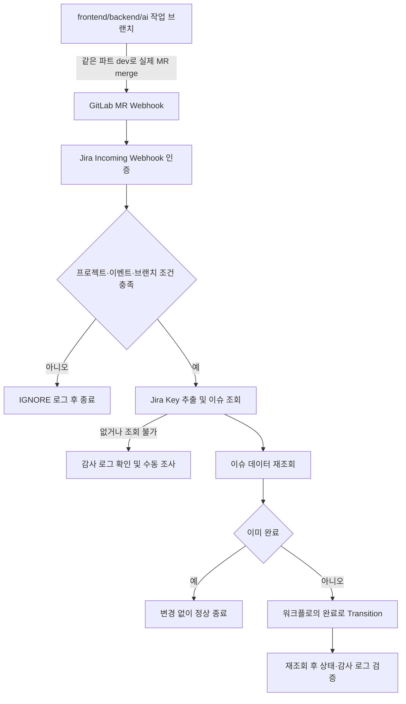

# GitLab MR 병합에 따른 Jira 이슈 자동 종료

## 적용 상태와 조사 결과

2026-09-09 기준 Jira Automation 규칙 `GitLab part dev merge to Done`을 생성·활성화하고,
GitLab 프로젝트에 Jira 전용 Webhook `Jira issue completion`을 추가했다.
Merge request events만 선택했고 SSL 검증과 Jira 전용 custom header 인증을 사용한다.
기존 Jenkins Push Webhook은 수정하지 않았다. 실제 테스트 MR을 이용한 payload 수신,
Automation actor 권한, 워크플로 전환은 아직 검증하지 않았으므로 인수 테스트 전까지는 제한 검증 상태다.

저장소 조사 결과:

- `backend/`: Spring Boot, `Jenkinsfile`, `deploy.sh`.
- `frontend/`: React/Vite, `Jenkinsfile`, `deploy.sh`.
- `ai/`: 현재 작업 폴더에 존재하는 미추적 작업. 이번 작업에서 수정하지 않는다.
- `infra/`, `ops/`, `observability/`: 로컬 구성, 운영·검증 스크립트, 관측성.
- `scripts/`, `docs/`: 개발 도구와 문서. 추적된 `.gitlab-ci.yml`이나 Jira 자동화 정의는 없다.
- 기존 `docs/infra/CI_CD.md`는 master 배포 흐름을 설명하며, frontend Jenkinsfile도 master 배포를 제한한다.
  이번 자동화의 part/dev 병합 조건은 **이슈 종료 기준**이며 배포 기준을 바꾸지 않는다.
- 조회 시 현재 브랜치는 `infra/chore/S15P21A405-34-jenkins-pipeline`이었다.
  로컬 remote-tracking 목록에 part/dev가 없었지만 원격 부재를 의미하지는 않는다.
  최신 원격 브랜치와 보호 규칙은 적용 전에 GitLab에서 확인한다.
- `.gitignore`, `.claude/`, `CLAUDE.md`, `ai/`의 기존 사용자 변경은 보존한다.

## 선택한 방식

**GitLab Merge Request Webhook → Jira Automation Incoming Webhook**을 사용한다.
별도 수신 서버, Jenkins 단계, GitLab CI Job, Jira REST 클라이언트를 만들지 않는다.
웹훅은 MR 병합을 직접 전달하고 Jira의 기본 Transition 동작은 프로젝트 워크플로를 따른다.
CI Job 방식은 파이프라인 실행과 실제 MR 병합을 추가로 구분해야 하며,
별도 API 서버 방식은 배포·인증·장애 대응 부담이 생겨 이번 범위에서는 선택하지 않았다.

목표는 기능 작업의 dev 통합 시점에 해당 작업 이슈만 완료하는 것이다.
운영 배포 성공, 에픽 완료, 파트 main 승격까지 의미하지 않는다.

## 동작 흐름



## 브랜치 및 이벤트 계약

모든 조건을 AND로 검사한다. payload는 GitLab 기본 JSON이며 사용자 정의 템플릿은 사용하지 않는다.

| 필드 | 필수 조건 |
| --- | --- |
| `object_kind` | `merge_request` |
| `event_type` | `merge_request` |
| `project.path_with_namespace` | `s15-bigdata-dist-sub1/S15P21A405` |
| `object_attributes.action` | `merge` |
| `object_attributes.state` | `merged` |
| `object_attributes.source_branch` | 아래 정규식 전체 일치 |
| `object_attributes.target_branch` | source의 첫 경로 + `/dev` |

`project`는 대상 프로젝트이고 MR 식별자는 `object_attributes.iid`다.
병합 가능 상태나 자동 병합 예약을 병합 완료로 취급하지 않는다.
버전별로 없는 필드가 있는 `merged_at` 또는 merge commit SHA를 필수 조건으로 삼지 않는다.
필수 값이 없거나 형식이 다르면 조건 불일치로 처리하고 조건을 느슨하게 바꾸지 않는다.
필드 의미는 [GitLab MR 이벤트 공식 문서](https://docs.gitlab.com/user/project/integrations/webhook_events/#merge-request-events)를 따른다.

Source 정규식:

```regex
^(frontend|backend|ai)/[a-z][a-z0-9-]*/(S15P21A405-[0-9]+)-[a-z0-9]+(?:-[a-z0-9]+)*$
```

type은 소문자로 시작하는 경로 한 구간이다. feat/fix/refactor/chore/test/docs/perf 등을 허용한다.
description은 소문자·숫자의 kebab-case로 제한한다. 다른 프로젝트 키, 추가 경로,
복수 Jira 키, 공백은 허용하지 않는다. 키의 `[0-9]+`는 요청한 숫자 패턴을 ASCII로 명시한 것이다.
MR 제목·본문·커밋 메시지에서 키를 찾지 않는다.

| Source 예시 | Target | 결과 |
| --- | --- | --- |
| frontend/feat/S15P21A405-101-map | frontend/dev | 101번 이슈 전환 대상 |
| backend/feat/S15P21A405-34-nearby | backend/dev | 34번 이슈 전환 대상 |
| ai/refactor/S15P21A405-70-pca | ai/dev | 70번 이슈 전환 대상 |
| frontend/feat/S15P21A405-101-map | backend/dev | 무시 |
| backend/dev | backend/main | 무시 |
| ai/main | master 또는 main | 무시 |

## Jira UI 설정

UI 언어·업데이트에 따라 issue가 work item, project가 space로 표시될 수 있다.
Jira 프로젝트 `S15P21A405`의 설정에서 **Automation**을 열고 새 규칙을 만든다.
범위는 이 프로젝트만 선택한다. 이름 예: `GitLab part dev merge to Done`.
관리자가 규칙 생성 권한과 Automation 사용량 한도를 먼저 확인한다.

### 1. 트리거와 인증

1. **Incoming webhook** 트리거를 선택한다.
2. 이슈 선택 기준은 **No work items from the webhook**을 선택한다.
   GitLab JSON에는 Jira의 issues 배열이 없으므로 아래에서 직접 조회한다.
3. 아래 조건과 액션을 모두 구성한 다음 저장한다. 연결 전에는 테스트용 이슈만 준비한다.
4. 트리거에서 생성된 URL과 secret을 GitLab 담당자에게 안전하게 전달한다.
   UI가 URL 발급을 위해 규칙 활성화를 요구하면 GitLab 연결 전 먼저 조건 전체를 검토한다.

인증 헤더는 `X-Automation-Webhook-Token`이다. 과거 legacy URL은 사용하지 않는다.
헤더를 지원하지 않는 발신자는 URL 뒤 `/SECRET` 방식도 공식 지원하지만 이 문서는 헤더 방식을 기본으로 한다.
자세한 발급·교체 절차는 [Incoming webhook 공식 문서](https://support.atlassian.com/cloud-automation/docs/configure-the-incoming-webhook-trigger-in-atlassian-automation/)를 따른다.
이슈 미지정 옵션의 공식 예시는 [Atlassian 설정 예시](https://support.atlassian.com/jira/kb/how-to-trigger-the-user-created-automation-rule-using-system-webhooks/)에서 확인할 수 있다.

### 2. 공통 변수

현재 규칙은 **Create variable** 액션으로 Jira 키만 생성한다.

| 이름 | Smart value |
| --- | --- |
| jiraKey | `{{webhookData.object_attributes.source_branch.match("(S15P21A405-[0-9]+)")}}` |

키를 추출해도 다음 검사를 통과하기 전까지 조회·전환에 사용하지 않는다.
`match()`는 캡처 그룹을 반환하므로 추출 표현식에는 그룹을 하나만 둔다.
[텍스트 Smart values 공식 문서](https://support.atlassian.com/cloud-automation/docs/jira-smart-values-text-fields/)

### 3. 공통 조건

위 이벤트 계약의 조건을 순서대로 추가한다. 각 조건을 통과해야 다음 단계가 실행되는 AND 구조다.
필드는 `{{webhookData.object_kind}}`처럼 접근한다.
Source에는 **Smart values condition**의 정규식 일치 비교를 사용하고 위 전체 정규식을 입력한다.
Target 비교값은 `{{webhookData.object_attributes.source_branch.substringBefore("/")}}/dev`다.
이벤트 종류·프로젝트 경로·프로젝트 ID `1441006`·merge action/state는 하나의 구분자 결합 문자열로
정확히 비교한다. 일반 문자열 비교는 equals로 한다.

조건 불일치는 이후 액션 없이 종료하며, Audit log의 불일치 조건이 IGNORE의 근거다.
키가 없는 입력도 안전하게 무시된다. 누락 값이 빈 문자열로 평가되는지 실제 Audit log에서 확인한다.
변수 처리 자체가 실패한다면 전환 액션은 실행하지 않고 해당 실행을 조사한다.
로그에는 JSON 전체, 헤더, URL, MR 설명을 출력하지 않는다.

### 4. 조건 통과 후 이슈 조회

먼저 Log action:

```text
mr={{webhookData.object_attributes.iid}} source={{webhookData.object_attributes.source_branch}} target={{webhookData.object_attributes.target_branch}} key={{jiraKey}} result=ELIGIBLE
```

**Lookup work items** 액션에 아래 JQL을 설정한다:

```jql
project = S15P21A405 AND key = "{{jiraKey}}"
```

다음 Smart values condition에서 `{{lookupIssues.size}}`가 `1`과 같은지 검사한다.
없는 키의 JQL이 오류로 처리되는 환경에서는 이 로그에 도달하지 않을 수 있다.
그 경우 ELIGIBLE 로그와 Lookup 액션 오류를 함께 조사한다.
조회 불가는 실제 미존재와 권한 부족을 구분하지 못하므로 관리자 확인 전 이슈를 만들지 않는다.

### 5. 조회 결과가 하나인 경우

**Branch rule / related issues → JQL**에 같은 JQL을 입력한다.
`Only include issues that have changed since the last time this rule executed`가 표시되면 해제한다.
이 브랜치 안에서 아래 순서로 설정한다:

1. **Re-fetch work item data**.
2. **Work item fields condition**에서 Status가 프로젝트의 실제 **완료**와 같지 않은 경우만 통과시킨다.
   이미 완료이면 여기서 정상 종료하며 전환·댓글·수정은 하지 않는다.
3. **Transition work item** 액션의 목적지 상태에서 실제 **완료**를 선택한다. 숫자 transition ID를 작성하지 않는다.
4. **Re-fetch work item data** 후 Status가 **완료**인지 다시 확인한다.
5. 확인을 통과한 경우에만 공통 필드와 `result=DONE`을 로그에 남긴다.

각 로그는 `mr={{webhookData.object_attributes.iid}} source={{webhookData.object_attributes.source_branch}} target={{webhookData.object_attributes.target_branch}} key={{jiraKey}} result=...` 형식을 유지한다.
액션이 실패하면 뒤의 로그가 실행되지 않을 수 있다. 이때 Jira 자체 감사 로그가 실패 결과의 기준이다.
분기 밖에서 성공을 기록하지 않는다.

조회·변수·로그·재조회 액션은 [Jira Automation actions](https://support.atlassian.com/cloud-automation/docs/jira-automation-actions/)를 따른다.
JQL 분기의 이슈 컨텍스트는 [Automation branches](https://support.atlassian.com/cloud-automation/docs/jira-automation-branches/)를 참고한다.
이 문서는 중첩 If/else나 유료 고급 Branch with conditions 기능을 요구하지 않는다.
로그의 조건식은 [조건부 Smart values](https://support.atlassian.com/cloud-automation/docs/jira-smart-values-conditional-logic/)를 따른다.

### 6. 워크플로와 중복 처리 한계

Automation actor에 해당 이슈의 조회·전환 권한이 있어야 한다. 작업 유형별 워크플로에서
현재 상태 → 완료 전환이 허용되고 필수 필드·validator가 충족되는지 확인한다.
완료 상태 이름이 `완료` 등으로 다르면 담당자와 의미를 확인하고 **조건과 액션 모두 같은 실제 상태**를 선택한다.
Done 카테고리라고 해서 취소 등 다른 상태를 임의로 동일 취급하지 않는다.
워크플로 변경이나 권한 확대는 이 자동화 설치의 기본 작업이 아니다.
[Transition 공식 설명](https://support.atlassian.com/cloud-automation/docs/transition-an-issue-with-automation/)

순차 재전송은 재조회 후 완료이면 아무것도 하지 않아 멱등적이다.
다만 **동시 중복 실행의 원자적 중복 제거는 이 방식으로 보장하지 못한다**.
두 실행이 동시에 미완료 상태를 읽으면 한 실행의 전환이 실패할 수 있다.
감사 로그와 최종 상태를 확인하고 완료이면 재전환하지 않는다.
동시 중복까지 오류 없는 exactly-once가 필수라면 잠금·영속 중복 키를 가진 수신기 등
추가 설계가 필요하며, 현재 구성을 그 요구까지 완료했다고 간주하지 않는다.
이슈를 의도적으로 다시 열었을 때 과거 이벤트를 재전송하면 다시 완료가 될 수도 있다.
따라서 수동 재전송 전에 재오픈 이력을 반드시 확인한다.

## GitLab UI 설정

1. ODY 프로젝트의 Maintainer/Owner가 **Settings → Webhooks**를 연다.
2. 기존 Jenkins Webhook은 수정하지 않고 Jira 전용 Webhook 하나만 추가한다.
3. URL에는 발급받은 `JIRA_WEBHOOK_URL`의 실제 값을 UI에서 입력한다.
4. **Custom headers**에 이름 `X-Automation-Webhook-Token`, 값은 `JIRA_WEBHOOK_SECRET`의 실제 값을 입력한다.
5. **Merge request events**만 선택한다. Push/Pipeline/Job 이벤트는 선택하지 않는다.
6. SSL verification을 켠 상태로 저장한다. 사용자 정의 payload 템플릿은 비워 둔다.
7. 아래 실제 MR 병합 인수 테스트를 수행한다.

GitLab의 일반 **Secret token**은 `X-Gitlab-Token`으로 전송되므로 Jira 인증 헤더를 대체하지 못한다.
CI/CD Variables에 같은 이름을 등록해도 Webhook UI의 값으로 자동 치환되지 않는다.
Custom headers는 GitLab 17.0에서 정식 제공되었으며 현재 SSAFY GitLab 프로젝트 UI에서 제공됨을 확인했다.
GitLab 일반 Secret token 필드는 비워 두고 Jira 헤더를 custom header에 저장했다.
브랜치 필터는 Push용 기능에 의존하지 않고 Jira 조건에서 처리한다.
[GitLab Webhooks 공식 설정](https://docs.gitlab.com/user/project/integrations/webhooks/)

## 필요한 Secret과 보안

| 관리용 이름 | 용도·저장 위치 |
| --- | --- |
| JIRA_WEBHOOK_URL | Jira 발급 수신 주소. GitLab 전용 Webhook URL 필드에만 저장 |
| JIRA_WEBHOOK_SECRET | Jira 발급 인증 비밀. GitLab Custom header 값에 저장 |

별도 `.env` 또는 CI 변수 파일은 필요 없다. GitLab PAT, Jira API Token, Jira 이메일도 필요 없다.
실제 값은 코드·커밋·스크린샷·명령 기록·문서에 남기지 않는다.
테스트 때도 비밀을 공개하는 curl verbose/debug나 전체 payload 로그를 사용하지 않는다.
Webhook 편집 권한은 최소 인원에게만 부여한다. 기본 payload에 포함될 수 있는 개인정보와
Recent events/audit log의 접근 권한·보존 정책을 관리자와 확인한다.
이 인증은 공유 secret에 의존하므로 유출되면 payload를 위조할 수 있다.
프로젝트 문자열 검사는 추가 방어일 뿐, GitLab 서버 서명 검증이나 API 재조회가 아니다.
유출 시 규칙을 중지하고 Jira에서 secret을 재생성한 다음 GitLab 값을 교체한다.

## 테스트

### 오프라인 계약 테스트

저장소 루트에서 Python 표준 라이브러리만 사용한다:

```powershell
python -B -m unittest discover -s scripts/tests -p test_gitlab_jira_automation.py -v
```

이 테스트는 필드·정규식·분기와 순차 재전송의 **Python 정책 모델**을 검증한다.
수신 서버가 아니며 네트워크 호출이나 Jira 변경을 하지 않는다.
Jira의 정규식/Smart value 실행, 권한, transition 성공을 검증하는 통합 테스트는 아니다.

| 필수 사례 | 입력 요약 | 정책 모델 결과 / 실제 인수 기준 |
| --- | --- | --- |
| 1 | backend/feat/S15P21A405-34-nearby → backend/dev merge | 전환 요청 / 해당 이슈 완료 |
| 2 | frontend/feat/S15P21A405-101-map → frontend/dev merge | 전환 요청 / 해당 이슈 완료 |
| 3 | ai/feat/S15P21A405-70-pca → ai/dev merge | 전환 요청 / 해당 이슈 완료 |
| 4 | backend 기능 → backend/main | IGNORE / 상태 변경 없음 |
| 5 | backend/dev → backend/main | IGNORE / 상태 변경 없음 |
| 6 | frontend/feat/no-jira-key → frontend/dev | IGNORE / 상태 변경 없음 |
| 7 | frontend 기능 → backend/dev | IGNORE / 상태 변경 없음 |
| 8 | backend/fix/S15P21A405-34-fix → backend/dev, 이미 완료 | 수정 없음 |
| 9 | closed이지만 merged 아님 | IGNORE / 상태 변경 없음 |

추가로 type 7종·파트 조합, open/update/approval/approved, merge+opened 불일치,
파트 main 승격, 타 프로젝트 payload, 잘못된 키·입력, 없는 이슈, 순차 재전송을 검사한다.

### 실제 인수 테스트 — 아직 미실행

1. 담당자 승인하에 frontend/backend/ai용 **테스트 전용 Jira 이슈 3개**를 준비한다.
   위 34/101/70은 예시이며 실제 업무 이슈를 테스트 목적으로 종료하지 않는다.
2. 각 파트에서 `<part>/test/<실제 테스트 키>-jira-automation` 브랜치를 만들고
   검토 가능한 테스트 변경만 MR로 올린다. 대상은 각각 frontend/dev, backend/dev, ai/dev다.
3. 생성·수정·승인 단계에서는 상태가 변하지 않는지 확인한다. 실제 merge 후 해당 이슈만 완료인지 확인한다.
4. 표의 제외 사례는 실제 dev/main 승격을 강행하지 말고, 격리된 테스트 규칙에서
   비식별 payload로 검사한다. 실제 프로젝트용 규칙은 테스트 종료 후 임의 데이터로 호출하지 않는다.
5. 완료 이벤트를 순차 재전송하여 이슈 이력에 추가 전환이 없음을 확인한다.
6. 없음/조회권한 없음, 허용되지 않는 전환, 잘못된 secret도 테스트 규칙에서 확인한다.
   API 장애와 동시 중복은 아직 미검증으로 기록하고 운영 장애를 일부러 만들지 않는다.
7. 기록: MR iid/source/target/key, GitLab 전송 시각·결과, Jira audit 실행 ID·결과,
   전후 상태·이슈 이력. 비밀은 기록하지 않는다.

GitLab 테스트 버튼이 만드는 이벤트는 실제 merge를 보장하지 않는다.
테스트 전송 성공만으로 인수 테스트를 대체하지 않는다.
특히 새 Jira endpoint는 잘못된 secret에서도 HTTP 200을 반환할 수 있으므로
**GitLab HTTP 결과 + Jira Audit log + 이슈 실제 상태**를 모두 확인해야 한다.
[Atlassian Incoming webhook 진단](https://support.atlassian.com/automation/kb/check-if-the-incoming-webhook-trigger-in-an-automation-rule-is-correct/)

## 실패 대응·관측·롤백

| 증상 | 확인 및 대응 |
| --- | --- |
| 키 없음/파트 불일치 | IGNORE 정상. 브랜치 규칙을 확인하고 기존 MR을 임의로 재병합하지 않음 |
| Jira 실행 없음 | GitLab Recent events, URL·custom header·규칙 활성 상태 확인. 200도 인증 증거 아님 |
| Lookup 실패 또는 조회 수 1 불일치 | 키 오타·프로젝트 범위·Browse 권한·이슈 보안 확인. 자동 생성 금지 |
| 전환 액션 실패 | Jira 감사 로그의 actor 권한·워크플로 조건·validator·필수 필드 확인 |
| Jira/API 일시 장애 | 복구 후 현재 상태·재오픈 이력을 확인하고 해당 이벤트만 재전송 |
| 중복 수신 | 순차 완료이면 정상 무시. 동시 실패는 최종 상태와 양쪽 실행 로그를 대조 |
| 이벤트 누락 | Webhook 비활성화·전송 실패와 Jira 실행 한도 확인. 병합된 MR 목록과 audit를 대조 |

전환 실패 확인은 [Atlassian transition 문제 해결](https://support.atlassian.com/jira/kb/jira-automation-fails-to-transition-an-issue-to-destination-status/)도 참고한다.
HTTP 수신 성공 뒤의 Jira 액션 실패가 GitLab에 전달되거나 자동 재시도된다고 가정하지 않는다.
재전송은 GitLab의 해당 이벤트 상세 화면에서 지원되는 경우 사용한다.
이력이 만료됐거나 버튼이 없다면 관리자가 해당 MR과 이슈를 대조하여 수동 복구한다.
Jira 상태를 무조건 되돌렸다가 재전송하는 방식은 금지한다.

운영 담당자는 도입 직후와 실패 신고 시 조건 불일치, `ELIGIBLE / DONE` 및
Lookup·Transition 오류를 Audit log에서 확인한다. 새 메트릭 서버나 주기 작업은 추가하지 않았다.

롤백은 **이 Jira 규칙 중지 → Jira 전용 GitLab Webhook 비활성화/제거** 순서다.
기존 Jenkins Webhook, Jenkinsfile, 배포 스크립트는 건드리지 않는다.
이미 완료된 이슈는 자동으로 원복하지 않는다. 감사 로그·이슈 이력을 근거로 담당자가 필요한 것만 재전환한다.
저장소 산출물만 되돌리려면 이번 문서와 테스트 및 CI/CD 문서 링크만 제거한다.

## 운영 적용 완료 체크리스트

- [x] GitLab Custom headers 제공 여부와 HTTPS URL·SSL 검증 설정 확인
- [x] Jira 프로젝트 범위 규칙 생성 및 활성화
- [ ] 필드 조건·Smart values·JQL 분기 실제 실행 확인
- [ ] 모든 작업 유형의 완료 목적지와 actor 전환 권한 확인
- [ ] 세 파트 실제 병합, 제외 사례, 이미 완료 재전송 확인
- [ ] 실패·재전송 담당자 지정, 동시 중복 한계 수용 여부 결정
- [x] Jira 규칙 활성화 및 GitLab MR Webhook 저장
- [ ] 실제 이벤트의 Audit log/이슈 이력 증거 확보

설정 export가 필요하면 Jira UI가 제공하는 실제 export를 사용하고 URL·secret·계정 식별자를
검토·제거한 뒤 별도로 관리한다. 존재 여부를 검증하지 않은 import JSON은 제공하지 않는다.
