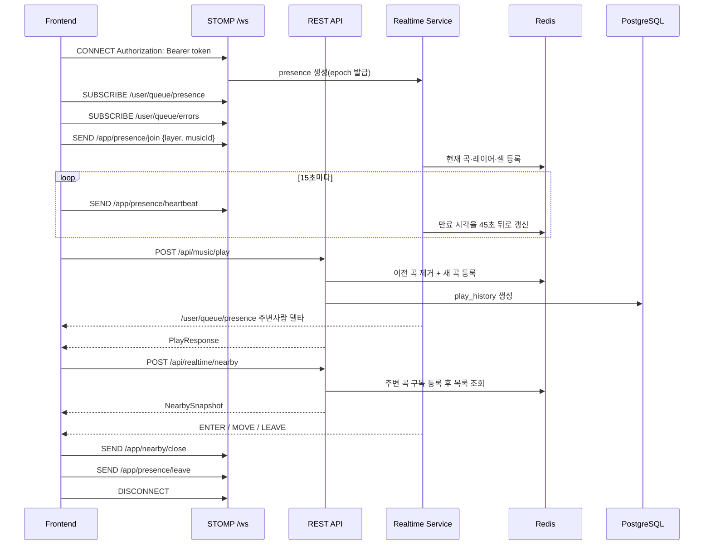
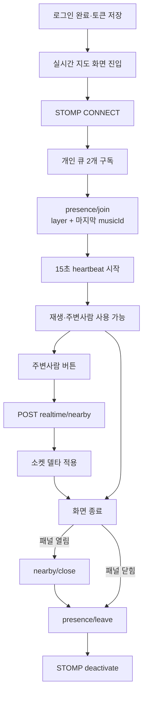

# 실시간 Presence · 재생 · 주변사람 프론트 연동 가이드

> 대상: 프론트엔드 개발자 및 구현을 맡는 AI  
> 기준: 2026-09-16 현재 백엔드 실제 코드  
> 담당 범위: 박지원 구현분(WebSocket 기반, Presence, 음악 재생/종료, 만남 횟수, 주변사람)  
> 중요: 이 문서는 과거 기획안이 아니라 **현재 실행되는 코드의 계약**을 설명한다.

## 1. 먼저 알아야 할 현재 상태

### 1.1 활성 조건

이 문서의 REST 컨트롤러와 실시간 서비스 대부분은 Spring의 `realtime` 프로파일에서만 활성화된다.

- 백엔드 실행 시 `realtime` 프로파일이 반드시 포함돼야 한다.
- Redis와 PostgreSQL 연결이 필요하다.
- `realtime` 프로파일이 없으면 `/api/music/play`, `/api/music/play/end`, `/api/realtime/nearby`가 등록되지 않는다.
- 무로그인 데모에서는 이 프로파일을 끄는 방식으로 기존 동작과 분리돼 있다.

### 1.2 로그인은 사실상 필수

현재 `SecurityConfig`는 임시로 HTTP 요청을 `permitAll` 처리하지만, 아래 기능은 모두 `Principal.getName()`으로 사용자를 찾는다.

- 유효한 access token을 보내지 않으면 `Principal`이 없어 정상 동작하지 않는다.
- REST와 WebSocket 모두 `Authorization: Bearer {accessToken}`을 반드시 사용한다.
- JWT subject는 사용자 email이며, 서버는 이 값을 사용자 식별자로 사용한다.
- WebSocket CONNECT는 토큰이 없거나 access token이 아니면 즉시 거부한다.

즉, `permitAll`을 비로그인 지원으로 해석하면 안 된다. 인증 설정이 원복되면 HTTP도 정식으로 `authenticated()`가 적용될 예정이다.

### 1.3 현재 프론트 코드에서 반드시 바꿔야 하는 경로

현재 프론트 목 API 경로와 실제 백엔드 경로가 다르다.

| 기능 | 현재 프론트의 옛 경로 | 실제 백엔드 경로 |
| --- | --- | --- |
| 재생 선언 | `POST /api/music/{id}/play` | `POST /api/music/play` |
| 재생 종료 | 없음 | `PATCH /api/music/play/end` |
| 주변사람 | `GET /api/users/nearby?layer=...` | `POST /api/realtime/nearby` |

프론트 `API_ENDPOINTS`는 다음 형태로 추가하거나 교체해야 한다.

```ts
export const API_ENDPOINTS = {
  // ...
  music: {
    // 기존 detail, search 등은 유지
    play: "/api/music/play",
    playEnd: "/api/music/play/end",
  },
  realtime: {
    nearby: "/api/realtime/nearby",
  },
} as const;
```

프론트의 `ApiErrorCode`에도 최소한 아래 코드를 추가해야 한다.

```ts
type RealtimeErrorCode = "PRESENCE_ERROR" | "SERVICE_UNAVAILABLE";
```

### 1.4 배포 프록시 확인 필요

백엔드 WebSocket endpoint는 `/ws`지만 저장소에서 운영 Nginx의 `/ws` 프록시 설정은 확인되지 않았다.

배포 환경에서는 인프라 담당자와 다음을 확인해야 한다.

- `/ws/**` 요청이 백엔드 8080으로 전달되는가
- `Upgrade`, `Connection` 헤더가 전달되는가
- SockJS의 HTTP fallback 요청도 같은 backend로 전달되는가
- WebSocket 연결 제한 시간이 Presence heartbeat보다 충분히 긴가

프록시가 준비되지 않은 상태에서 프론트와 백엔드가 다른 origin이면, 프론트 origin의 `/ws`로 연결하지 말고 `NEXT_PUBLIC_API_URL`과 같은 실제 백엔드 base URL을 사용해야 한다.

## 2. 전체 통신 구조



## 3. 프론트에 필요한 패키지

현재 프론트에는 STOMP와 SockJS 패키지가 없다.

```bash
npm install @stomp/stompjs sockjs-client
npm install -D @types/sockjs-client
```

- Spring endpoint는 `/ws`이며 SockJS가 활성화돼 있다.
- 프론트에서는 `new SockJS("{backendBaseUrl}/ws")` 방식으로 연결하는 것을 권장한다.
- WebSocket 코드는 브라우저 API를 사용하므로 Next.js Client Component 또는 클라이언트 전용 모듈에서 실행한다.

## 4. 공통 REST 계약

모든 REST 응답은 다음 봉투를 사용한다.

### 성공

```json
{
  "success": true,
  "data": {},
  "error": null
}
```

### 실패

```json
{
  "success": false,
  "data": null,
  "error": {
    "code": "PRESENCE_ERROR",
    "message": "실시간 처리 중 오류가 발생했습니다."
  }
}
```

현재 프론트의 `api<T>()` 함수는 이 봉투에서 `data`를 꺼내므로 그대로 재사용할 수 있다.

### 공통 오류

| HTTP | code | 의미 | 프론트 처리 |
| ---: | --- | --- | --- |
| 400 | `INVALID_INPUT` | body 누락, enum 오류, 음수 재생 시간 | 입력값과 타입 확인 |
| 404 | `MUSIC_NOT_FOUND` | 기준 곡이 DB에 없음 | 곡 정보 새로고침 또는 이전 화면 이동 |
| 422 | `PRESENCE_ERROR` | 미접속, 기준 곡 없음, 좌표 없음, 오래된 요청 | 소켓 재연결 후 join, 필요하면 요청 재시도 |
| 503 | `SERVICE_UNAVAILABLE` | 주변 곡 조회 준비 안 됨 또는 실패 | 잠시 후 재시도 UI |
| 500 | `INTERNAL_SERVER_ERROR` | 처리되지 않은 서버 오류 | 오류 안내 및 로그 수집 |

`PRESENCE_ERROR`는 세부 원인을 REST body로 나누지 않는다. 프론트는 공통적으로 소켓 연결과 join 상태를 확인해야 한다.

## 5. WebSocket/STOMP 공통 계약

### 5.1 연결 정보

| 항목 | 값 |
| --- | --- |
| SockJS endpoint | `/ws` |
| 클라이언트 발행 prefix | `/app` |
| 개인 수신 prefix | `/user` |
| 실시간 데이터 구독 | `/user/queue/presence` |
| 실시간 오류 구독 | `/user/queue/errors` |
| CONNECT 헤더 | `Authorization: Bearer {accessToken}` |

주의: HTTP `Authorization` 헤더와 별개로 STOMP CONNECT frame의 native header에도 토큰을 넣어야 한다.

### 5.2 서버가 보내는 공통 봉투

REST의 `ApiResponse`와 WebSocket 형식은 다르다.

```ts
type RealtimeEventType =
  | "NEARBY_SNAPSHOT"
  | "NEARBY_ENTER"
  | "NEARBY_MOVE"
  | "NEARBY_LEAVE"
  | "PRESENCE_ERROR"
  | "VIEWPORT_SNAPSHOT"
  | "VIEWPORT_ENTER"
  | "VIEWPORT_MOVE"
  | "VIEWPORT_LEAVE"
  | "VIEWPORT_CELL_COUNTS";

interface RealtimeEnvelope<T> {
  type: RealtimeEventType;
  seq: number;
  ts: number;
  payload: T;
}
```

- `seq`: 사용자별 메시지 순번이다. 연결 중에는 증가한다.
- `ts`: 서버가 메시지를 만든 Unix epoch millisecond다.
- 마지막 소켓 연결이 끊기면 seq 상태도 사라진다. 재연결 후에는 이전 연결의 seq와 이어진다고 가정하면 안 된다.
- 같은 연결에서 `seq <= lastAppliedSeq`인 메시지는 중복 또는 역순 메시지로 보고 버린다.
- seq가 건너뛰면 스냅샷 재조회로 복구한다.

현재 `VIEWPORT_*` enum은 존재하지만 실제 발행 기능은 구현되지 않았다. 이벤트 이름이 있다는 이유만으로 기다리면 안 된다.

### 5.3 권장 연결 코드

```ts
"use client";

import { Client, type IMessage } from "@stomp/stompjs";
import SockJS from "sockjs-client";

type Envelope<T> = {
  type: string;
  seq: number;
  ts: number;
  payload: T;
};

export function createRealtimeClient(params: {
  backendBaseUrl: string;
  accessToken: string;
  onPresence: (event: Envelope<unknown>) => void;
  onError: (event: Envelope<unknown>) => void;
  onConnected: (client: Client) => void;
}) {
  const client = new Client({
    webSocketFactory: () => new SockJS(`${params.backendBaseUrl}/ws`),
    connectHeaders: {
      Authorization: `Bearer ${params.accessToken}`,
    },
    reconnectDelay: 5_000,
    heartbeatIncoming: 10_000,
    heartbeatOutgoing: 10_000,
    onConnect: () => {
      client.subscribe("/user/queue/presence", (message: IMessage) => {
        params.onPresence(JSON.parse(message.body));
      });
      client.subscribe("/user/queue/errors", (message: IMessage) => {
        params.onError(JSON.parse(message.body));
      });

      // 구독을 먼저 만든 뒤 join한다.
      params.onConnected(client);
    },
  });

  return client;
}
```

STOMP 자체 heartbeat와 `/app/presence/heartbeat`는 역할이 다르다. STOMP heartbeat를 설정해도 Presence TTL은 갱신되지 않으므로 애플리케이션 heartbeat를 별도로 보내야 한다.

## 6. Presence 생명주기

### 6.1 CONNECT

WebSocket CONNECT가 성공하면 서버가 자동으로 다음 작업을 한다.

1. 소켓 세션 ID와 email을 연결한다.
2. 새로운 접속 버전인 `epoch`을 만든다.
3. Redis에 presence를 생성한다.
4. 아직 곡과 레이어는 없는 정지 상태로 둔다.

CONNECT만으로는 다른 사용자에게 노출되지 않는다. 반드시 join이 필요하다.

### 6.2 입장·복원: `/app/presence/join`

소켓 연결과 개인 큐 구독이 끝난 다음 보낸다.

```json
{
  "layer": 1,
  "musicId": 12345
}
```

| 필드 | 타입 | 필수 | 규칙 |
| --- | --- | --- | --- |
| `layer` | integer | O | 현재 구현 기준 `1~8` |
| `musicId` | long | O | 실제 존재하고 16차원 좌표가 있는 곡 |

동작:

- 서버가 `musicId`의 좌표를 조회해 해당 layer의 2축 좌표와 셀을 계산한다.
- 클라이언트가 좌표를 보내지 않는다.
- join은 재생 기록을 만들지 않는다.
- join은 만남 횟수를 올리지 않는다.
- 첫 join은 주변사람을 보고 있는 다른 사용자에게 `NEARBY_ENTER`를 발생시킬 수 있다.
- 레이어를 바꿀 때는 같은 `musicId`와 새 `layer`로 join을 다시 보낸다.

현재 코드상 join의 `musicId`를 서버의 최신 play history와 대조하지 않는다. 프론트는 `ody:my-music-id` 등 자신이 저장한 실제 마지막 재생곡만 보내야 한다.

응답:

- 별도 ACK payload가 없다.
- join 처리 오류를 `/user/queue/errors`로 일관되게 보내는 배선도 아직 없다.
- 따라서 프론트가 null, 범위 밖 layer, 임의 musicId를 보내지 않도록 먼저 검증해야 한다.

### 6.3 heartbeat: `/app/presence/heartbeat`

body 없이 15초마다 보낸다.

```ts
const heartbeatTimer = window.setInterval(() => {
  if (client.connected) {
    client.publish({ destination: "/app/presence/heartbeat", body: "{}" });
  }
}, 15_000);
```

- 서버 TTL: 45초
- 서버 만료 확인 주기: 5초
- 탭이 백그라운드에 있어 타이머가 늦어질 수 있으므로 `visibilitychange`에서 즉시 한 번 보내는 것이 안전하다.
- heartbeat가 이미 만료된 presence를 되살리지는 않는다.

만료된 뒤 heartbeat를 보내면 `/user/queue/errors`로 다음 메시지가 온다.

```json
{
  "type": "PRESENCE_ERROR",
  "seq": 12,
  "ts": 1789520000000,
  "payload": {
    "code": "PRESENCE_STALE",
    "message": "접속이 만료됐다. 다시 연결해야 한다"
  }
}
```

`/app/presence/resync`는 이전 화면을 자동으로 복원하지 않는다. 호출하면 `PRESENCE_STALE`을 보내 새 연결에서 상태를 다시 보내도록 알린다. `PRESENCE_STALE`을 받으면 다음 순서로 복구한다.

1. 기존 STOMP 연결 해제
2. 새 STOMP 연결
3. 개인 큐 재구독
4. `/app/presence/join` 재전송
5. `requestSeq`를 1부터 시작해 `/app/presence/viewport` 재전송
6. 주변사람 패널이 열려 있었다면 `POST /api/realtime/nearby` 재호출

### 6.4 명시적 종료: `/app/presence/leave`

body 없이 보낸다.

```ts
client.publish({ destination: "/app/presence/leave", body: "{}" });
```

- 현재 소켓 접속의 presence, listeners, 셀, 주변사람 구독을 정리한다.
- 다른 사용자에게 필요한 `NEARBY_LEAVE`가 발행될 수 있다.
- 별도 ACK는 없다.
- STOMP DISCONNECT 또는 브라우저 연결 종료 시 서버도 자동 정리를 시도한다.
- 비정상 종료로 DISCONNECT 처리가 늦더라도 TTL 만료가 최종 정리한다.
- 재접속과 이전 연결의 종료가 겹쳐도 epoch 방어로 새 연결 상태를 지우지 않는다.

권장 종료 순서:

1. 주변사람 패널이 열려 있으면 `/app/nearby/close`
2. `/app/presence/leave`
3. heartbeat timer 정리
4. STOMP `deactivate()`

## 7. 음악 재생 선언 REST

### 7.1 `POST /api/music/play`

음악 재생으로 위치를 이동시키는 유일한 API다.

사전 조건:

1. 로그인 access token이 있어야 한다.
2. WebSocket CONNECT가 끝나 presence가 생성돼 있어야 한다.
3. `/app/presence/join`을 한 번 보내 현재 layer가 있어야 한다.

요청:

```json
{
  "musicId": 12345,
  "source": "MAP"
}
```

```ts
type PlaySource = "MAP" | "JOURNEY" | "PLAYLIST" | "FOLLOW";

interface PlayRequest {
  musicId: number;
  source: PlaySource;
}
```

좌표, layer, email은 보내지 않는다.

- layer: 현재 presence 값 사용
- email: JWT subject 사용
- 좌표: 서버가 musicId의 16차원 좌표로 계산

성공 응답의 `data`:

```json
{
  "playHistoryId": 98765,
  "musicId": 12345,
  "layer": 1,
  "x": 0.421,
  "y": 0.673,
  "cellX": 6,
  "cellY": 10
}
```

```ts
interface PlayResponse {
  playHistoryId: number;
  musicId: number;
  layer: number;
  x: number;
  y: number;
  cellX: number;
  cellY: number;
}

const played = await api<PlayResponse>("/api/music/play", {
  method: "POST",
  body: JSON.stringify({ musicId, source }),
});
```

성공 시 서버 내부 동작:

1. 이전 곡의 청취자·셀에서 사용자 제거
2. 새 곡의 청취자·셀에 사용자 등록
3. 주변사람 델타 발행
4. `play_history` 생성, 초기 `played_ms=0`
5. 같은 layer·같은 곡을 먼저 듣고 있던 사용자와 만남 횟수 기록

만남 기록은 비동기이며 동일 사용자 쌍은 3분 안에 한 번만 증가한다.

주의:

- 주변사람 소켓 이벤트는 REST 응답보다 먼저 도착할 수 있다.
- 같은 곡을 다시 선언하면 위치와 인원수는 중복 변경되지 않지만 `play_history`는 새로 생성된다.
- 새 곡 재생 성공 시 반환된 `playHistoryId`를 현재 재생 세션과 함께 저장해야 한다.

### 7.2 권장 호출 시점

HTML audio가 실제 재생을 시작한 시점에 호출한다. 곡을 바꿀 때는 다음 순서를 권장한다.

1. 이전 재생의 누적 시간을 계산
2. 이전 `playHistoryId`로 `/api/music/play/end` 호출
3. 새 오디오 재생 시작
4. 새 `musicId`로 `/api/music/play` 호출
5. 응답의 새 `playHistoryId` 저장

종료 요청 실패가 새 재생을 영구적으로 막게 하지는 말되, 재시도할 수 있도록 이전 종료 정보를 잠시 보관하는 것이 좋다.

## 8. 음악 재생 종료 REST

### 8.1 `PATCH /api/music/play/end`

요청:

```json
{
  "playHistoryId": 98765,
  "playedMs": 185000
}
```

```ts
interface PlayEndRequest {
  playHistoryId: number;
  playedMs: number;
}

await api<null>("/api/music/play/end", {
  method: "PATCH",
  body: JSON.stringify({ playHistoryId, playedMs }),
});
```

규칙:

- `playedMs`는 0 이상의 정수 millisecond다.
- 응답 `data`는 `null`이다.
- 같은 `playHistoryId`로 다시 호출하면 마지막 값으로 덮어쓴다.
- 재생 종료는 presence 위치를 바꾸지 않는다.
- `pause`, `ended`, 곡 교체, 플레이어 종료 시점에서 호출할 수 있다.
- 다른 사용자의 ID 또는 존재하지 않는 ID는 현재 구현상 422 `PRESENCE_ERROR`다.

`beforeunload` 요청만 믿으면 브라우저가 요청을 취소할 수 있다. 재생 중간 저장이 필요하면 주기 저장이나 `visibilitychange`를 함께 고려한다.

## 9. 주변사람 패널

### 9.1 열기: `POST /api/realtime/nearby`

body가 없다.

```ts
const snapshot = await api<NearbySnapshot>("/api/realtime/nearby", {
  method: "POST",
});
```

이 API는 조회만 하는 것이 아니라 다음 작업을 함께 한다.

1. 내 현재 곡을 기준곡으로 확인
2. 기준곡과 유사한 곡 최대 10개 조회
3. 해당 곡들의 실시간 변화를 먼저 구독 등록
4. 현재 소켓 메시지 순번 기록
5. 곡별 청취자를 평면 사람 목록으로 반환

WebSocket 없이도 REST 응답 자체는 가능하지만, 이후 델타를 잃는다. 정상 UI에서는 반드시 소켓 연결과 `/user/queue/presence` 구독을 먼저 끝낸다.

응답 타입:

```ts
interface NearbyPerson {
  email: string;
  nickname: string | null;
  imageUrl: string | null;
  meetingCount: number;
  riderCount: number;
  musicId: number;
  title: string;
  artist: string;
  distance: number;
}

interface NearbySnapshot {
  anchorMusicId: number;
  snapshotSeq: number;
  people: NearbyPerson[];
}
```

예시:

```json
{
  "success": true,
  "data": {
    "anchorMusicId": 100,
    "snapshotSeq": 7,
    "people": [
      {
        "email": "user@example.com",
        "nickname": "off_beat",
        "imageUrl": "https://example.com/profile.png",
        "meetingCount": 4,
        "riderCount": 0,
        "musicId": 201,
        "title": "Example Song",
        "artist": "Example Artist",
        "distance": 0.42
      }
    ]
  },
  "error": null
}
```

표시 규칙:

- 내 email은 목록에서 제외된다.
- 사람 목록은 곡의 거리 순서로 조립된다.
- 같은 곡 안에서 사람 순서는 보장되지 않는다.
- UI 상태는 배열 index가 아니라 `email`을 key로 관리한다.
- `nickname`, `imageUrl`은 null일 수 있다.
- 프로필 버튼의 대상 식별자로 `email`을 사용한다.
- `meetingCount`는 나와 해당 사용자의 누적 만남 횟수다.
- `riderCount`는 따라가기 기능이 아직 없어 현재 항상 0이다.
- nickname과 imageUrl은 서버에서 5분 캐시되므로 프로필 수정 직후 바로 바뀌지 않을 수 있다.

### 9.2 REST와 소켓 사이 순서 처리

패널을 열 때 다음 알고리즘을 사용한다.

1. `/user/queue/presence` 구독 완료
2. nearby 이벤트 임시 buffer 시작
3. `POST /api/realtime/nearby` 호출
4. 응답 `people`로 목록 전체 교체
5. buffer에서 `seq <= snapshotSeq`인 이벤트 폐기
6. `seq > snapshotSeq`인 이벤트를 순서대로 적용
7. 이후 `seq <= lastAppliedSeq`인 중복 이벤트 폐기

구독 등록이 목록 조회보다 먼저라서 같은 사용자가 스냅샷과 델타 양쪽에 들어올 수 있다. 모든 델타는 email 기준으로 멱등 처리한다.

### 9.3 델타 타입

```ts
interface NearbyDelta {
  email: string;
  nickname: string | null;
  imageUrl: string | null;
  meetingCount: number | null;
  riderCount: number | null;
  musicId: number | null;
}
```

#### `NEARBY_ENTER`

목록에 사용자를 추가한다. 이미 있으면 같은 email 항목을 갱신한다.

```json
{
  "type": "NEARBY_ENTER",
  "seq": 8,
  "ts": 1789520000000,
  "payload": {
    "email": "other@example.com",
    "nickname": "off_beat",
    "imageUrl": null,
    "meetingCount": 4,
    "riderCount": 0,
    "musicId": 201
  }
}
```

#### `NEARBY_MOVE`

같은 사용자의 `musicId`, 표시 정보, 횟수를 갱신한다. 사용자가 없다면 upsert하거나 스냅샷을 다시 조회한다.

#### `NEARBY_LEAVE`

email로 목록에서 제거한다. LEAVE에서는 email을 제외한 필드가 null이다.

```json
{
  "type": "NEARBY_LEAVE",
  "seq": 9,
  "ts": 1789520001000,
  "payload": {
    "email": "other@example.com",
    "nickname": null,
    "imageUrl": null,
    "meetingCount": null,
    "riderCount": null,
    "musicId": null
  }
}
```

#### `NEARBY_SNAPSHOT`

내 곡이 바뀌었고 패널이 열린 상태면 서버가 내 구독 기준을 다시 만들고 전체 목록을 보낸다.

- payload는 REST의 `NearbySnapshot`과 같다.
- 기존 목록을 부분 수정하지 말고 전체 교체한다.
- 적용 후 `lastAppliedSeq`는 envelope의 `seq`로 갱신한다.

### 9.4 현재 델타 계약의 제한

`NEARBY_ENTER`와 `NEARBY_MOVE` payload에는 다음 필드가 없다.

- `title`
- `artist`
- `distance`

따라서 스냅샷과 완전히 같은 행을 델타만으로 새로 만들 수 없다. 프론트 구현 전에 아래 중 하나를 팀에서 선택해야 한다.

1. 델타 DTO에 `title`, `artist`, `distance`를 추가하는 백엔드 보완
2. 델타 행에서는 곡 상세를 별도 조회
3. ENTER/MOVE 수신 시 nearby REST 스냅샷 재조회
4. 해당 필드가 없는 축약 행을 UI에서 허용

최종 화면이 제목·가수를 항상 표시한다면 **1번이 가장 안정적**이다. 이 결정 전에는 존재하지 않는 필드를 타입에 임의로 추가하지 않는다.

또한 곡 재생 시 주변 델타 발행이 비동기 만남 횟수 기록보다 먼저다. ENTER/MOVE의 `meetingCount`는 막 증가한 횟수보다 1 작을 수 있으며, 다음 스냅샷에서 최신값이 반영된다.

### 9.5 닫기: `/app/nearby/close`

패널이 닫힐 때 body 없이 보낸다.

```ts
client.publish({ destination: "/app/nearby/close", body: "{}" });
```

- 저장해 둔 주변 곡 구독을 제거한다.
- 별도 ACK는 없다.
- 이전 소켓의 늦은 close가 새 접속의 구독을 삭제하지 못하도록 epoch를 확인한다.
- close를 못 보내도 presence leave, disconnect, TTL 만료가 구독을 정리한다.

## 10. 주변사람 상태 적용 예시

```ts
type NearbyState = {
  anchorMusicId: number | null;
  peopleByEmail: Map<string, NearbyPerson>;
  lastSeq: number;
};

function applyNearbyEvent(
  state: NearbyState,
  event: RealtimeEnvelope<NearbySnapshot | NearbyDelta>,
) {
  if (event.seq <= state.lastSeq) return state;

  if (event.type === "NEARBY_SNAPSHOT") {
    const snapshot = event.payload as NearbySnapshot;
    return {
      anchorMusicId: snapshot.anchorMusicId,
      peopleByEmail: new Map(snapshot.people.map((p) => [p.email, p])),
      lastSeq: event.seq,
    };
  }

  const delta = event.payload as NearbyDelta;
  const next = new Map(state.peopleByEmail);

  if (event.type === "NEARBY_LEAVE") {
    next.delete(delta.email);
  } else {
    const old = next.get(delta.email);
    if (old) {
      next.set(delta.email, {
        ...old,
        nickname: delta.nickname,
        imageUrl: delta.imageUrl,
        meetingCount: delta.meetingCount ?? old.meetingCount,
        riderCount: delta.riderCount ?? old.riderCount,
        musicId: delta.musicId ?? old.musicId,
      });
    } else {
      // title·artist·distance가 델타에 없으므로 계약 결정 전 임의 생성하지 않는다.
      // 여기서는 스냅샷 재조회 또는 축약 행 처리가 필요하다.
    }
  }

  return { ...state, peopleByEmail: next, lastSeq: event.seq };
}
```

## 11. 권장 화면 진입 흐름



구현 순서:

1. access token 확인
2. STOMP 연결
3. `/user/queue/presence`, `/user/queue/errors` 구독
4. 마지막 musicId와 현재 layer로 `/app/presence/join`
5. 애플리케이션 heartbeat 시작
6. 그 뒤에 재생 선언과 주변사람 버튼 활성화

재연결의 `onConnect`에서도 3~5를 다시 수행해야 한다.

## 12. 기능 검증 시나리오

### 12.1 단일 사용자

- [ ] realtime 프로파일 서버가 실행된다.
- [ ] 유효한 access token으로 `/ws` CONNECT가 성공한다.
- [ ] 개인 큐 2개를 구독한다.
- [ ] join 후 `/api/music/play`이 200을 반환한다.
- [ ] 응답에 `playHistoryId`, 좌표, 셀이 있다.
- [ ] `/api/music/play/end`가 `data: null`로 성공한다.
- [ ] 재생 종료 뒤에도 presence 위치는 유지된다.
- [ ] 주변사람 API가 `anchorMusicId`, `snapshotSeq`, `people`을 반환한다.
- [ ] nearby close와 presence leave 후 오류 없이 연결을 닫는다.

### 12.2 두 사용자

사용자 A와 B는 서로 다른 실제 계정과 토큰을 사용한다.

- [ ] A와 B가 각각 별도 브라우저 또는 시크릿 창에서 접속한다.
- [ ] 둘 다 같은 layer로 join한다.
- [ ] A가 주변사람 패널을 열고 REST 스냅샷을 받는다.
- [ ] B가 A의 기준곡 또는 이웃곡을 재생하면 A가 ENTER 또는 MOVE를 받는다.
- [ ] B가 연결을 끊으면 A가 LEAVE를 받는다.
- [ ] A가 패널을 닫은 뒤 B가 곡을 바꿔도 A에게 nearby 델타가 오지 않는다.
- [ ] 같은 layer·같은 곡에서 만난 뒤 다음 스냅샷의 `meetingCount`가 증가한다.
- [ ] 3분 안에 같은 두 사용자가 다시 만나도 count가 중복 증가하지 않는다.

### 12.3 재접속과 만료

- [ ] heartbeat를 45초 이상 중단하면 presence가 정리된다.
- [ ] 만료 후 heartbeat에서 `PRESENCE_STALE`을 받는다.
- [ ] 재연결·재구독·join 후 기능이 복구된다.
- [ ] 이전 연결의 늦은 leave/nearby close가 새 연결 상태를 지우지 않는다.
- [ ] 재연결 후 seq 기준을 0부터 새 연결 기준으로 초기화한다.

## 13. 아직 구현되지 않은 기능

아래 항목은 타입이나 핸들러 골격이 있어도 현재 사용할 수 없다.

| 기능 | 현재 상태 | 프론트 처리 |
| --- | --- | --- |
| `/app/presence/viewport` | 빈 핸들러 | 호출하지 않음 |
| `/app/presence/resync` | `PRESENCE_STALE` 전송 | 재연결 + join + viewport + nearby REST로 복구 |
| `VIEWPORT_*` 이벤트 | 발행 서비스 없음 | 기다리지 않음 |
| 따라가기/동승자 계산 | 어댑터 대기 | `riderCount`는 항상 0 |
| 다중 서버 실시간 브리지 | 없음 | 현재 단일 서버 전제 |
| join 성공 ACK | 없음 | 연결·입력 선검증 필요 |
| nearby 델타의 곡 메타 | 일부 필드 없음 | §9.4 계약 결정 필요 |

## 14. 프론트 구현 완료 조건

- [ ] 옛 목 API 경로를 실제 REST 경로로 교체했다.
- [ ] `PRESENCE_ERROR`, `SERVICE_UNAVAILABLE` 타입을 추가했다.
- [ ] STOMP CONNECT에 Bearer token을 넣었다.
- [ ] CONNECT 직후 개인 큐를 먼저 구독한다.
- [ ] join 완료 흐름 전에는 play/nearby 버튼을 비활성화한다.
- [ ] STOMP heartbeat와 별개로 15초 애플리케이션 heartbeat를 보낸다.
- [ ] 재연결할 때 구독, join, viewport, heartbeat와 열린 nearby 패널을 다시 만든다.
- [ ] 재생별 `playHistoryId`와 `playedMs`를 관리한다.
- [ ] nearby REST 요청 중 들어온 델타를 buffer하고 `snapshotSeq` 기준으로 정리한다.
- [ ] nearby 목록을 email key로 멱등 갱신한다.
- [ ] `NEARBY_SNAPSHOT`은 전체 교체한다.
- [ ] 패널 닫기와 화면 종료 메시지를 보낸다.
- [ ] `/presence/resync`가 화면을 자동 복원한다고 가정하지 않는다.
- [ ] nearby 델타 곡 메타 처리 방식을 백엔드와 확정한다.

## 15. 백엔드 코드 기준 위치

계약 확인이 필요할 때 아래 파일을 기준으로 본다.

```text
backend/src/main/java/com/ssafy/backend/
├─ config/WebSocketConfig.java
├─ config/SecurityConfig.java
├─ realtime/config/StompAuthChannelInterceptor.java
├─ realtime/session/WebSocketSessionEventListener.java
├─ realtime/presence/controller/PresenceStompController.java
├─ realtime/play/MusicPlayController.java
├─ realtime/play/dto/
├─ realtime/nearby/controller/NearbyController.java
├─ realtime/nearby/controller/NearbyStompController.java
├─ realtime/nearby/dto/
├─ realtime/messaging/RealtimeEnvelope.java
└─ realtime/messaging/RealtimeEventType.java
```
