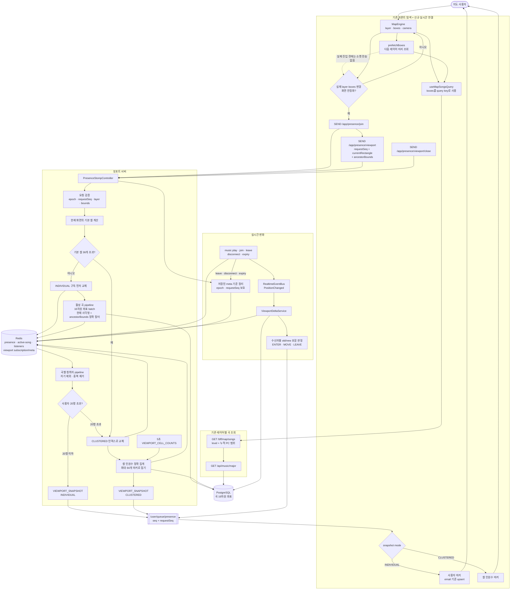

# Implementation Plan: 실시간 뷰포트 사용자

**Branch**: `backend/feat/S15P21A405-76-viewport-snapshot`  
**Spec**: [spec.md](spec.md)  
**Status**: Draft — D1~D4 확정, 전체 명세 검토 후 구현 대기

## Summary

프론트에 이미 구현된 레이어별 `/api/music/major` 조회의 `boxes`를 viewport 소켓의 누적 탐색 범위로 재사용한다. 기존 Presence Redis 상태를 사용해 현재 탐색 분기와 화면 안의 사용자를 조회한다. 기본 셀이 36개 이하이고 사용자가 20명 이하이면 개별 사용자 스냅샷과 셀 구독, 둘 중 하나라도 초과하면 셀 인원수 스냅샷과 5초 갱신을 사용한다. `PositionChanged`를 소비해 개별 구독자에게 ENTER·MOVE·LEAVE를 보내고, close·disconnect·expiry·reconnect 전 과정을 epoch와 requestSeq로 보호한다.

## Technical Context

| 항목 | 선택 |
| --- | --- |
| Runtime | Java, Spring Boot |
| 실시간 진입 | STOMP `/app/presence/**` |
| 개인 응답 | `/user/queue/presence`, `/user/queue/errors` |
| 상태 저장 | Redis Set/Hash + Lua 원자 교체 |
| 곡 좌표 | PostgreSQL `music.location`, 기존 배치 Reader 재사용 |
| 레이어 곡 조회 | 기존 `GET /api/music/major`: level 1 정적, level 2+ 누적 LayerBox |
| 내부 변화 전달 | `RealtimeEventBus`의 `PositionChanged` |
| 활성화 | `@Profile("realtime")` |
| 뷰포트 설정 | grid 16, 셀 임계값 36, 사용자 상한 20, 마커 상한 64, debounce 250ms, 갱신 5초 |
| 테스트 | JUnit 5, Mockito, 실제 Redis 조건부 통합 테스트, 2세션 STOMP 시나리오 |

## Constitution Check

| 원칙 | 설계 반영 |
| --- | --- |
| Spec First | 현재 문서 검토 후에만 구현 시작 |
| Contract First | 요청·스냅샷·델타·복구 계약을 contracts에 선행 정의 |
| Test Before Done | 각 Jira마다 단위·Redis 통합·컨텍스트 검증 후 검토 |
| Coordinate Stability | 기존 16차원 좌표와 1~8 레이어, 정규화 규칙 재사용 |
| Exploration Consistency | 기존 major의 boxes와 viewport의 ancestorBounds가 같은 값을 사용 |
| Observability | 처리 시간·모드·후보 수·stale 거부를 측정 |
| No Silent Assumptions | requestSeq·20명 상한·깊은 레이어 정확 집계·email 식별자를 확정 결정으로 기록 |
| Architecture Boundaries | music 영역은 기존 Reader/Port로만 읽고 수정하지 않음 |

## Project Structure

```plaintext
backend/src/main/java/com/ssafy/backend/realtime/
├─ geometry/
│  ├─ Viewport.java                         # 범위 검증·포함 판정
│  └─ CellGrid.java                         # 걸치는 셀·격자 뭉침
├─ presence/
│  ├─ controller/PresenceStompController.java
│  ├─ dto/ViewportRequest.java
│  └─ service/PresenceLifecycleService.java # 레이어 이동 이벤트·이탈 정리 연결
├─ viewport/
│  ├─ dto/
│  │  ├─ ViewportSnapshot.java
│  │  ├─ ViewportDelta.java
│  │  └─ ViewportCellCounts.java
│  ├─ repository/ViewportRedisRepository.java
│  ├─ service/ViewportService.java
│  ├─ service/ViewportDeltaService.java
│  └─ scheduler/ViewportCellCountsScheduler.java
├─ event/PositionChanged.java
└─ port/MusicLocationPort.java

backend/src/main/resources/redis/
├─ viewport-subscription-replace.lua
└─ viewport-subscription-close.lua

backend/src/test/java/com/ssafy/backend/realtime/viewport/
├─ geometry/
├─ service/
├─ repository/
├─ integration/
└─ ViewportRealtimeContextTests.java

frontend/src/                              # 기존 구현 확인 + FE 연동 요청, 이 브랜치에서 수정하지 않음
├─ components/map/engine/map-engine.ts    # 기존 boxes·prefetch·stack의 원본
├─ hooks/queries/use-map-songs-query.ts   # 기존 level+boxes 조회와 무기한 캐시
└─ realtime/viewport-client.ts            # 신규 소켓 연동 지점
```

## Architecture Flow



## Runtime Flows

### F1. 레이어 데이터 수명주기

1. 사이트 진입 시 기존 `useMapSongsQuery([])`가 level 1 곡 집합을 받는다.
2. 다음 레이어 후보가 생기면 엔진이 현재 사각형을 `prefetchBoxes`에 추가해 미리 조회한다.
3. prefetch만으로 presence·viewport 상태를 바꾸지 않는다.
4. 실제 descend로 layer·boxes가 바뀌면 그 boxes가 새 탐색 경로의 원본이 된다.
5. 응답이 늦으면 엔진은 임시 곡 집합으로 전환할 수 있고, 도착한 결과로 화면을 다시 맞춘다.
6. 올라갈 때는 기존 stack과 무기한 query cache가 이전 layer·곡·camera·boxes를 복원한다.

### F2. 프론트 실시간 요청 순서

1. STOMP 연결 후 `/user/queue/presence`, `/user/queue/errors`를 먼저 구독한다.
2. `/app/presence/join`으로 현재 곡과 레이어를 복원한다.
3. 팬·줌 종료 후 250ms debounce하여 `/app/presence/viewport`를 보낸다.
4. 레이어 이동은 실제 layer·boxes 변경 → 화면 안정화 → join → 새 레이어 viewport 순서로 처리한다.
5. 늦은 major 응답으로 화면이 바뀌면 더 큰 requestSeq로 viewport를 다시 보낸다.
6. 화면을 닫으면 `/app/presence/viewport/close`를 보낸다.

사용자 노출 상태는 아래 순서로 유지한다.

1. connect는 접속 정보만 만들고 아직 노출하지 않는다.
2. 최초 join은 직전 곡 위치에 배치하고 ENTER를 만든다.
3. 레이어 이동 join과 곡 재생은 새 위치로 옮기고 MOVE를 만든다.
4. playEnd는 재생 시간만 저장하고 마지막 위치의 노출은 유지한다.
5. leave·disconnect·TTL 만료에서 위치를 제거하고 LEAVE를 만든다.

### F3. INDIVIDUAL 최초 스냅샷

1. layer 1은 빈 ancestorBounds, layer N은 이전 N-1개 LayerBound인지 검증한 뒤 현재 raw PC 사각형을 정규화해 걸치는 기본 셀을 계산한다.
2. Lua로 이전 셀 구독을 새 셀 구독으로 교체한다. epoch/requestSeq가 오래되면 중단한다.
3. 해당 셀의 활성 곡 ID를 pipeline으로 읽는다.
4. 곡의 16차원 좌표를 한 번에 읽고 현재 raw PC 사각형과 ancestorBounds로 정확히 거른다.
5. 남은 곡의 `layer-listeners`를 pipeline으로 읽는다.
6. 요청자를 제외하고 사용자 표시 정보를 배치 해석한다.
7. 사용자가 20명 이하면 곡 위치별로 묶어 `VIEWPORT_SNAPSHOT`을 보낸다. 20명을 넘으면 구독을 CLUSTERED로 교체하고 셀 인원수를 보낸다.

### F4. CLUSTERED 최초·주기 스냅샷

1. 기본 셀이 36개를 넘거나 정확 필터 사용자가 20명을 넘으면 개별 셀 구독 없이 clustered 인덱스만 저장한다.
2. layer 1은 `cell:usercount:1`에서 화면 셀 수를 읽는다.
3. layer 2 이상은 화면 후보 곡의 16차원 좌표에 ancestorBounds를 적용한 뒤 곡별 청취자 수를 합산한다.
4. 셀 마커가 64개 이하가 될 때까지 16→8→4로 접는다.
5. 최초 `VIEWPORT_SNAPSHOT`과 5초 주기 `VIEWPORT_CELL_COUNTS`를 보낸다.

### F5. 실시간 델타

1. 최초 join·레이어 이동 join·play·leave가 이전/새 상태를 담은 `PositionChanged`를 발행한다. playEnd는 위치를 바꾸지 않으므로 발행하지 않는다.
2. 이전 셀 구독자와 새 셀 구독자의 합집합을 수신 후보로 구한다.
3. 후보의 viewport 메타를 한 번에 읽고 INDIVIDUAL + 최신 epoch인 사용자만 남긴다.
4. 변경 주체의 좌표·표시 정보·동승자 수는 이벤트 1건당 한 번만 구한다.
5. 각 수신자의 old/new 실제 포함 여부로 ENTER·MOVE·LEAVE를 결정하고 그 수신자의 requestSeq를 델타에 넣는다.
6. 개인 큐에 델타를 보낸다. 프론트는 현재 requestSeq와 다른 델타를 버리고, CLUSTERED 사용자는 다음 5초 집계로 반영한다.

### F6. 종료·재연결

1. close는 저장 메타의 셀 목록으로만 SREM하고 메타·clustered 인덱스를 지운다.
2. presence leave Lua도 viewport 정리를 함께 수행한다.
3. 모든 정리는 epoch를 확인하고, 명시 close는 requestSeq도 확인한다.
4. 재연결은 서버가 과거 상태를 추측하지 않는다. 프론트가 새 연결에서 구독→join→viewport→nearby/open을 재전송한다.

### F7. 관측성

1. viewport 요청 처리 시간, 최종 모드, 후보 셀·곡·사용자 수를 기록한다.
2. 델타는 수신 후보 수와 실제 발송 수를 기록한다.
3. stale epoch/requestSeq 거부와 close 이후 잔여 구독 검증 결과를 기록한다.
4. email·토큰·원시 16차원 좌표는 로그 본문과 metric tag에 넣지 않는다.
5. 단위 테스트와 로컬 `test,realtime` 실행 로그에서 필드 존재와 개인정보 제외를 확인한다.

## Ticket Delivery Plan

### S15P21A405-76 — 최초 스냅샷·개별 구독

0. **서베이** — 기존 placeholder, Presence Redis, 좌표 batch reader, publisher, 최신 프론트 boxes 계약 확인. 코드 변경 없음
1. **요청·기하 계약** — requestSeq, layer, currentRectangle, ancestorBounds DTO와 검증·셀 계산
2. **구독 저장소** — epoch/requestSeq 보호, 이전 셀 제거·새 셀 추가·meta 저장을 Lua로 원자 교체
3. **조회 경계** — 활성 곡·곡별 청취자 pipeline과 16차원 좌표 batch Port 연결
4. **개별 스냅샷** — 구독 먼저 등록, 정확 bounds 필터, 자기 제외, email·프로필·동승자 수 조립. 20명 초과는 일부 목록을 내리지 않고 CLUSTERED 필요 상태까지만 판정
5. **STOMP 연결** — 기존 `/app/presence/viewport` placeholder를 서비스와 개인 큐에 연결
6. **검증** — geometry·service 단위 테스트, 실제 Redis 통합 테스트, realtime context·compile/build
7. **STOP** — 변경 파일·메서드와 검증 결과를 사용자에게 보고하고 승인·커밋 후에만 141 진행

76 단독 브랜치는 INDIVIDUAL 적합 입력을 검증하는 중간 산출물이다. `CLUSTERED 필요`를 일부 사용자 목록으로 바꾸지 않으며, 해당 상태의 외부 응답과 프론트 연결은 141에서 완성한다.

### S15P21A405-141 — 뭉침·인원수 갱신

0. **서베이** — 기존 cell:usercount 정확도, 화면 셀 수, 프론트 셀 마커 입력 형태 확인. 코드 변경 없음
1. **모드 판정** — 기본 셀 36개 초과 또는 정확 사용자 20명 초과 시 CLUSTERED 전환
2. **설정·셀 뭉침** — RealtimeProperties에 사용자 상한을 추가하고 기본 16×16 셀을 8×8, 4×4 순서로 접어 마커 최대 64개 유지
3. **정확 인원수** — layer 1은 기존 Hash, layer 2+는 currentRectangle+ancestorBounds로 곡을 거른 뒤 청취자 합산
4. **구독 모드 교체** — INDIVIDUAL 셀 구독과 CLUSTERED 인덱스 사이를 Lua로 원자 전환
5. **주기 갱신** — CLUSTERED 화면만 5초마다 requestSeq가 포함된 전체 셀 인원수 갱신
6. **검증** — 합계 보존·분기 제외·모드 전환·실제 Redis·scheduler·context 테스트
7. **STOP** — 변경 파일·메서드와 검증 결과를 사용자에게 보고하고 승인·커밋 후에만 77 진행

### S15P21A405-77 — 델타·종료·재연결

0. **서베이** — PositionChanged 발행 지점, join 이동, leave/disconnect/expiry, resync placeholder 확인. 코드 변경 없음
1. **이벤트 입력 보강** — old/new layer·music·cell을 통일하고 play·join·leave가 모두 발행하도록 연결
2. **실시간 델타** — old/new 셀 후보와 수신자 meta를 batch로 읽고 실제 bounds로 ENTER·MOVE·LEAVE 분류
3. **오래된 델타 방지** — 각 델타에 수신 화면 requestSeq를 넣고 이벤트당 표시·좌표·동승자 조회를 한 번으로 제한
4. **명시 종료** — `/app/presence/viewport/close`에서 저장 meta만 사용해 Lua 정리
5. **자동 종료** — presence leave·disconnect·TTL expiry에서 viewport 셀·clustered·meta를 epoch 보호와 함께 정리
6. **재연결** — queue 구독→join→viewport→필요 시 nearby/open 재전송 계약과 resync 동작 정리
7. **검증** — 델타 단위·실제 Redis·두 세션·이전 epoch/requestSeq·전체 realtime 부팅·full build·demo 무영향
8. **STOP** — 사용자 최종 검토 후에만 커밋·push·MR 진행

## Query and Fanout Budget

| 경로 | 허용 조회 형태 |
| --- | --- |
| INDIVIDUAL snapshot | 활성 곡 Redis pipeline 1회 + 좌표 batch 1회 + 청취자 pipeline 1회 + 표시 batch/cache |
| CLUSTERED layer 1 | 셀 인원수 Hash 1회 |
| CLUSTERED layer 2+ | 활성 곡 pipeline 1회 + 좌표 batch 1회 + 청취자 수 pipeline 1회 |
| Delta 1건 | 구독자 Set 조회 + viewport meta pipeline + 주체 표시/좌표/동승자 조회 각 최대 1회 |
| Close | 저장 메타 기반 Lua 1회, DB 조회 없음 |

## Cross-team Requests

### Frontend 요청

- 기존 `MapEngine.boxes`를 viewport ancestorBounds의 유일한 원본으로 사용
- `prefetchBoxes`만 생긴 시점에는 join·viewport를 보내지 않음
- 실제 layer·boxes 변경과 화면 안정화 뒤 join→viewport 전송
- 늦은 major 응답으로 화면 범위가 바뀌면 더 큰 requestSeq로 viewport 갱신
- major 요청과 viewport 요청에 같은 boxes 값을 사용
- layer 0~7을 서버 1~8로 바꿔 전송
- 250ms debounce와 단조 증가 requestSeq 적용
- 소켓 연결 후 queue 구독을 먼저 완료
- 줌아웃의 query cache 적중을 요청 누락으로 처리하지 않음
- reconnect 시 join→viewport→nearby/open 재전송
- snapshot mode에 따라 사용자 마커와 셀 인원수 마커 전환

### 다른 Backend 영역

- `music.detail.MusicDetailReader.findLocationsByIds`를 realtime Port 어댑터에서 읽기만 한다.
- 프로필 공개 정책이 확정되면 Auth 담당에게 batch 공개 여부 조회 경계를 요청한다.
- 다중 인스턴스 운영 전 Infra와 외부 broker/event transport를 별도 설계한다.

## No Implementation Yet

이 계획 단계에서는 backend·frontend 코드, Redis Lua, 설정 파일을 수정하지 않는다. 사용자가 spec·contract·tasks를 승인한 뒤 S15P21A405-76의 첫 태스크부터 시작한다.
